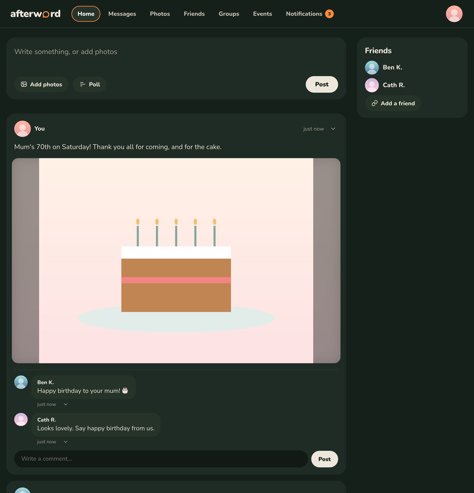
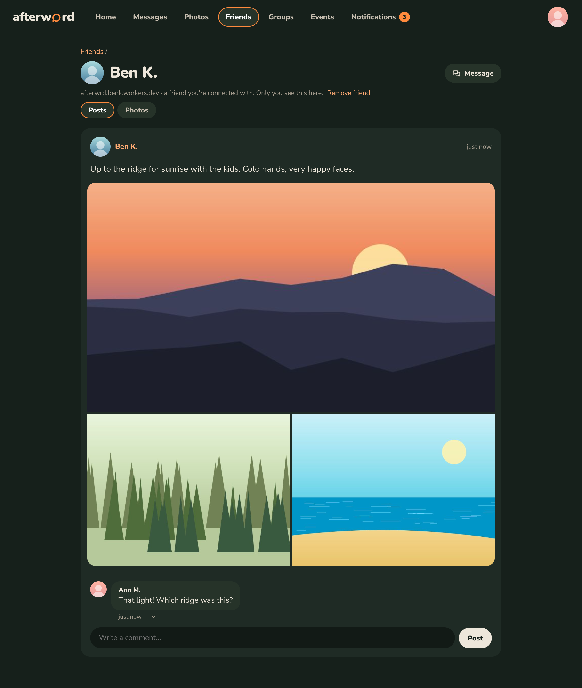
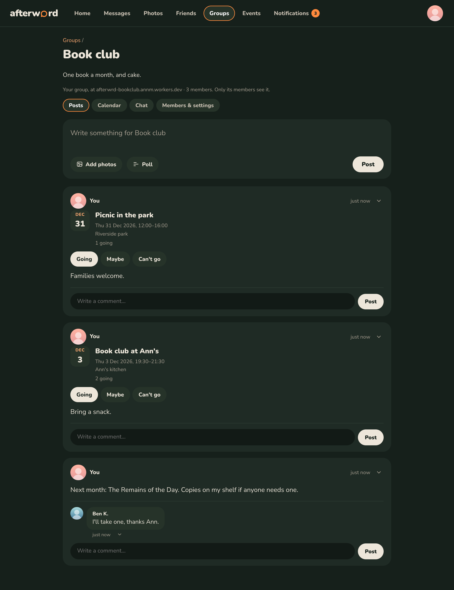
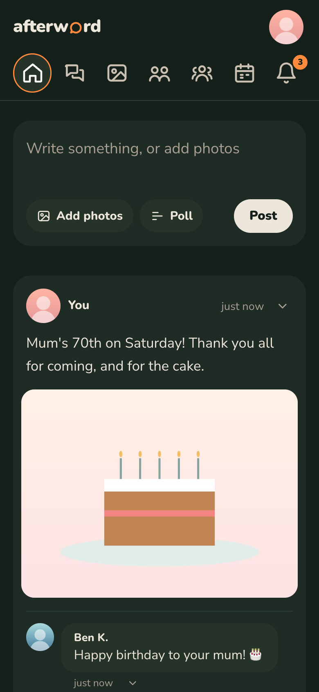
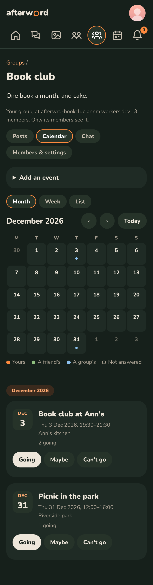

# afterwrd

A small, private social network of your own, with your Facebook years brought along. Post and share photos, comment,
message, and connect with friends who have their own afterwrd site; your Facebook download (posts, photos, comments, likes,
friends) comes too, under *Memories*. Only you sign in to your site; friends see it from their own. It runs in your own free Cloudflare account,
so no one else holds your data, and setting it up needs no terminal, no GitHub account and no card.

afterwrd isn't affiliated with or endorsed by Meta. It only reads the "Download your information" file Facebook
gives you; it never signs in to Facebook or fetches anything from it.

**Finding your way round.** *Home* is your posts and your friends' together, with a box to write in; *Messages*,
*Photos*, *Friends*, *Groups* and *Notifications* sit beside it. Your picture (top right) opens your profile, *Memories*
(everything from Facebook, with "On this day"), and your tools: *Your devices*, *Add to home screen*, *Import*,
*Download everything* and *Update*.

**Messages and the app.** *Messages* are one-to-one chats with friends, kept on your site and theirs, and each
group has a chat too (its messages go after 30 days: for keeping, there are posts). They aren't
end-to-end encrypted: both sites hold the text, as they do your posts. Add afterwrd to your phone's home screen
and it opens like an app, and can tell you when a friend sends you a message, even with the phone locked: that's the
only thing afterwrd ever notifies you about, and you can mute any chat. The notification is encrypted for your phone
by your own site, so the phone's push service (Apple's or Google's) passes it on without being able to read it; there's
no afterwrd server in between.

## What it looks like

Home, with your posts and friends' together (friends' posts come straight from their own sites):



A friend's page, read from their site; a group with its events; and on a phone, Home and a group's calendar:

 

 

<sub>The people and photos are made up (`npm run test:e2e -- screenshots` makes these pictures from local sites).</sub>

## How sites talk to each other

Each site is its own: friends' and groups' sites ask it for what their owner may see, when they look, with a key
for that one friendship, and nothing is copied. [PROTOCOL.md](PROTOCOL.md) describes the requests and what's sent,
for anyone curious or wanting to build something that talks to afterwrd.

## How afterwrd is made

afterwrd is written using an AI coding assistant (Anthropic's Claude), which has written all of its code. The
direction, and the decisions that shape it, are carefully considered human ones:
- what afterwrd is for, and what it deliberately isn't;
- keeping it private by default, with nothing copied to anyone else's site;
- one person per site, free to run, with no server to look after;
- calm, with no nudges or "X is going" notifications;
- every feature, and every one left out.

Because of that, it's built to be checked rather than trusted:

- **All the code is public**, under the GNU Affero General Public License, and every release is built from a tagged
  commit.
- **About 400 automated checks** run real copies of afterwrd on one computer, talking to each other as friends' sites
  and groups do, including deliberately forged and hostile requests. They run before every release.
- **Security reviews at each major step,** by separate AI agents reading the code without having written it. Every
  real finding has been fixed. There hasn't yet been a review by a human security expert, and one would be very
  welcome.
- **How sites talk to each other is written down** in [PROTOCOL.md](PROTOCOL.md), so the design can be examined and
  criticised on its own terms.

Found a problem? Please [open an issue](https://github.com/stemill/afterwrd/issues). For anything security-related,
[report it privately](https://github.com/stemill/afterwrd/security/advisories/new) instead, so it can be fixed before
it's public (see [SECURITY.md](SECURITY.md)).

## Install your own

**Easiest: use the install page, <https://afterwrd.app/>, on a phone or a computer.** Make your Cloudflare account
(step 1 below) and stay signed in, then press *Install*: afterwrd's installer at <https://install.afterwrd.app/>
connects to your Cloudflare account (you press *Allow* on Cloudflare's page; it lasts an hour and nothing is kept),
asks your name (and makes your address from it, `afterwrd.<your-name>.workers.dev`, if the account hasn't one yet), puts afterwrd there, and
sends you straight to your new site to make yourself its owner. It runs in the
maintainer's Cloudflare account, so it's one more thing to trust: if you'd rather not, the install page also offers
Cloudflare's own Deploy page, which puts the installer in your account instead. By hand, the steps in full:

You need a free Cloudflare account and a few minutes, on a phone or a computer. Bringing your Facebook years is optional, and
can be done any time.

1. **Make a Cloudflare account** at <https://dash.cloudflare.com/sign-up>. An email address is all it asks
   for; don't add a card. If you already use Cloudflare for other things, make a new account just for afterwrd:
   installing and updating ask for permission over every Worker and database in the account, for an hour, so in an
   account of its own that's only afterwrd.
2. **Create a Worker.** In the Cloudflare dashboard's left-hand menu: *Compute* → *Workers & Pages* →
   *Create application* (top right) → *Start with Hello World*. Replace the made-up *Worker name* (something
   like `blue-mud-43e4`) with `afterwrd`, or whatever you like: it becomes your address,
   `afterwrd.<your-name>.workers.dev`. Leave *Protect with Cloudflare Access* off (afterwrd has its own
   sign-in) and press *Deploy*. The first time, Cloudflare asks you to choose `<your-name>`.
3. **Paste in the installer.** Press *Copy installer* on the [install page](https://afterwrd.app/)
   (or download `installer.js` from the [latest release](https://github.com/stemill/afterwrd/releases/latest) and
   copy all of it), then in the Worker press *Edit code*, select everything there, paste over it and press *Deploy*.
4. **Run it.** Open your Worker's address. Choose your site's address, press **Connect Cloudflare** and, on
   Cloudflare's page, **Allow**: that lets the installer make your database and upload afterwrd, for an hour, and
   nothing is kept afterwards. (If connecting doesn't work, the installer can use an API token you make instead.)
5. **Make yourself the owner.** The installer hands over to afterwrd: give your name and create a passkey
   (your face, fingerprint or device PIN; there's no password). Then write a post, add photos, and connect
   with friends from *Friends*.
6. **Optional: bring your Facebook years.** On Facebook: Settings → *Download your information* → choose your
   profile, *All available information*, format **JSON**, media quality *High*. Facebook emails you when it's
   ready (from minutes to a day). Then choose *Import* in afterwrd's menu, pick the zip file(s), tick what to
   bring and press *Import and publish*. Your browser reads the download; only what you tick is uploaded. Your
   Facebook friends then appear on *Friends*, each with an *Invite* button that makes a message to send them.

Connecting uses Cloudflare's own sign-in for apps: afterwrd is a registered app there, and you can see or revoke what
you've allowed under *My Profile* → *Connected Applications*. The installer checks every file it downloads against the
fingerprint built into it, so what's installed is exactly the published release. Cloudflare's free plan allows 5 GB of
photos and videos. To check a release for yourself, see [Check it yourself](SECURITY.md#check-it-yourself).

### Keeping it safe

- **Turn on two-factor authentication for your Cloudflare account** (My Profile → Authentication). Anyone who gets
  into that account can see your whole site.
- **Only open a device link on your own phone or computer**: whoever opens it first gets owner access, so it works
  once and lasts an hour. *Your devices* can cancel unused links, remove a passkey or sign out everywhere.
- **Approve only friends you know.** A friend link can be passed on, so each one only asks: nothing is
  shared until you approve the request on *Friends*.
- **Photo locations are removed** from photos you post, and left out of a Facebook import unless you tick *Photo
  locations*; they can show where you live.
- **Keep it up to date.** Turn on automatic updates (one *Allow*, on the *Update* page) and the site installs each
  signed release by itself after a few days, or straight away with *Install it now*, its groups following.
- **Let your friends' sites check it.** One more *Allow* (read-only), and a few times a week a friend's afterwrd site
  checks yours is exactly a signed release, with nothing else uploaded in its place since the last check. A finding
  shows on both your Homes. Otherwise the owner's *Update* page installs a newer release, keeping
  your passkeys, connections and archive. (Pasting a newer `installer.js` over your afterwrd Worker does the same.) Home says so when an update
  fixes a security problem. To hear about every release, *Watch* the repository on GitHub (*Custom* → *Releases*) or
  follow its [releases feed](https://github.com/stemill/afterwrd/releases.atom).
- **Watch for new devices.** When a passkey is added, Home on your other devices says so for two weeks. If it
  wasn't you, remove it in *Your devices*.
- **Use a Cloudflare account just for afterwrd** if you use Cloudflare for anything else (see step 1).

## Running and developing the Worker

`worker/` is a Cloudflare Worker that shows your archive only to people who've signed in with a passkey.
You import from a page on the site itself: your browser reads the Facebook download and uploads only the
sections you choose. Posts, people and the rest go into D1, photos and videos into Durable Objects, and the
Worker builds pages from them, so search and filters work as they do locally. Cloudflare's free plan covers
it with no card needed: Workers, D1 and SQLite-backed Durable Objects only, no R2 or Zero Trust.

**One-off setup.** Every command below runs in `worker/`.

1. Create a free Cloudflare account at <https://dash.cloudflare.com/sign-up>. It needs only an email address.
2. Install the Worker's tools, sign in and deploy. The first time, wrangler asks you to pick a workers.dev
   subdomain and creates the database:
   ```sh
   cd worker
   npm install
   npx wrangler login                       # opens the browser
   npm run deploy
   ```
3. Make yourself the owner. Use the address the deploy printed:
   ```sh
   npm run owner -- "Your Name" --url https://afterwrd.<subdomain>.workers.dev
   ```
   Open the link and create a passkey.
4. Go to **Import** in the menu, choose the zip file(s) from Facebook (or the unzipped folder), tick what to
   publish and press **Import and publish**.

**Afterwards.** Nothing needs the terminal:

- **Import** again whenever you have a newer download, or to change what's published. Files already on the
  site aren't uploaded again, and files the new import doesn't use are deleted. Friends see the old version
  until the new one is complete.
- **Your devices** adds another phone or computer (a one-time link to open on it), removes a passkey (never your
  last one) and signs out everywhere. Only the owner signs in; there's no inviting others to your site, because
  friends see it from their own.
- **Photos and albums.** *Add photos* (on Photos) puts photos into a new or existing album, optionally shared
  as a post so friends see them in Feed. Albums you make can be renamed, described or deleted, and photos added
  here can be deleted. Any photo can be made your profile picture or cover, or upload one for it; they head
  your Posts page, and friends see your picture beside your posts.
- **New posts.** The owner can write posts on the site, with up to 20 photos, from the box at the top of
  *Posts*. Photos are resized to at most 2560px in the browser before uploading, which also removes the
  details phones hide in them (such as where a photo was taken), and they're collected in a *Posted on
  afterwrd* album. Importing again keeps them; deleting a post deletes its photos and comments.
- **Update** (marked when a new version is out) shows what's new and installs it: press *Connect Cloudflare*,
  *Allow* on Cloudflare's page, and it goes ahead, switching straight back if the new version doesn't work, and your
  groups follow. With automatic updates on, it says when the release will install itself, with *Install it now*. It's
  also where automatic updates and friends' checks are turned on or off, with what's coming next, what last happened,
  and what your site's checks of your friends' sites found. The connection lasts an hour and nothing is kept; sites updated
  from versions before 0.20.0 are offered *Forget it* for the token they used to remember.
- **Download everything** (the download icon) saves the whole site as one zip: posts, photos and videos,
  albums, comments (those written here, and yours on friends' sites), likes, friends and connections, as
  [ActivityStreams](https://www.w3.org/TR/activitystreams-core/) JSON, the open format the fediverse uses, with
  every photo and video. Everything has a permanent address (`https://<site>/posts/<key>`,
  `…/photos/sha256/<fingerprint>`, `…#c<n>` for a comment), so two friends' downloads agree on which comment
  replied to which post. The README inside explains the files. Keys and sign-in details are never included.
- **Friends** (the owner's alone) is one list: friends on afterwrd first, each with their posts and photos, then
  everyone from the Facebook download, marked *on afterwrd*, *invited*, or with an *Invite* button. Invite makes a
  friend link for that person (it lasts 30 days) and a message to send; when it's used you'll see who the invite
  was for, and approving links them to their Facebook self. Otherwise, say which Facebook friend an afterwrd friend
  is (matching names are suggested; nothing is linked without you), and their page links to your Facebook history
  together. Requests to be friends show on *Home* and at the top of *Friends* (with a count in the menu) for *Approve* or
  *Decline*, with why they came: a link, a group you're both in, or a friend's introduction.
- **Without a link.** A group's *Members* page has *Ask to be friends* by each member you're not friends with (the site
  asked checks with the group that you're in it). *Introduce* on a friend's card tells them and another friend about
  each other, with a note if you like; each sees it on *Home* and *Friends* and can ask. Someone you decline or remove can't ask again
  this way (you still can). There's no "people you may know": it would reveal who your friends' friends are.
- **Feed and connections.** *Friends → Add a friend* makes a one-time friend link (30 days) inside a message to
  send. Someone with an afterwrd site pastes it into *Add a friend* on their own site (or opens it and says where their site is), and confirms there. Someone without one
  presses *Set up your own afterwrd*: the installer carries the link along (after the `#`, so no server sees it),
  and their new site asks them to confirm as soon as they've made their passkey. Then you approve their request. Connections are mutual, and make you friends: *Feed* (only the owner sees it) shows the newest posts written on
  each connected site, and either of you can read the other's posts and photos (everything they've published)
  without leaving your own site: press their name. Comments you make are stored on your friend's site, with a
  copy kept on yours. Their photos and videos load straight from their site through links it signs, which last
  an hour or two. Sites exchange posts and comments as ActivityStreams too. Friends see what you've
  written on afterwrd, plus any parts of your Facebook download you chose to publish when importing. Either of you can press *Remove friend* on the other's page,
  which ends it all at once. If a friend's site stops answering for a day, Home stops mentioning it and *Friends*
  says so instead, so you can remove them. Two sites in the same Cloudflare account can connect too.
- **Groups.** Each group is its own small site: *Groups → Start a group* makes it a Worker of its own, with its own
  database, in your Cloudflare account (with the token remembered for updates, or one you paste; it needs to edit
  Workers and D1). It runs afterwrd in group mode: it holds the group and nothing else, and no one signs in to it.
  You and its members use it from your own sites, so being in a group isn't being friends, and a group's keys open
  nothing on anyone's site. Make an invite link on its *Members* page and send it round: anyone with an afterwrd site
  can use it for 14 days, but each use is only a request, and the group's admins let people in (up to 40 besides its
  owner). The owner can make members admins, and admins can remove people and delete anything in the group.
  Members read the group from their own sites when they open it, and can post (with up to 8 photos, which are copied
  to the group) and comment; a copy of their own words stays on their site. Nothing is sent round when someone posts:
  a comment sends a quiet note only to the people who wrote that post or commented on it, which shows in their
  *Notifications*. Each group has a *Calendar*: any member can add an event, and members say whether they're
  going. Adding one sends nothing to anyone; if you've said you're going, or might, you're told when its time, place
  or name changes or it's called off, and it's on your *Events* calendar. An event can repeat (every week, every two
  weeks, or monthly on the same date or weekday, for up to a year): people answer each date, and one date can be
  called off on its own. Only whoever added an event can
  change it; they, and the group's admins, can call it off. *Add to my calendar* downloads it for your phone's or
  computer's own calendar. The *Update* page brings your groups up to your site's version, and deleting a group removes its
  Worker and database. A free Cloudflare account holds about 9 groups besides your site (10 databases in all).
- **Events.** *Events → Make an event* makes one on your own site and invites the friends you tick: only they see
  it, from their own sites, where it shows in *Notifications* and on their *Events* page. They answer Going, Maybe or
  Can't go; everyone invited sees who's going and who might, and only you see who can't, or hasn't answered (or whose
  site didn't take the invitation). Change it or call it off, and everyone invited who hasn't said no is told. You can
  invite more people later, or quietly take an invitation back. *Events* also shows a calendar of everything you could
  go to, your own events, friends' and your groups', by month, week or as a list.
- **Comments.** You and your friends (from their own sites) can comment under a post or photo; comments show
  straight away. Friends can delete their own, and you can delete any. *Notifications* lists comments on your
  posts and photos, and comments on friends' posts and photos you've commented on too, with a count in the menu
  of those that are new to you. Comments are kept when you import again, and stay if you remove a friend, until you
  delete them.
- **Keeping up, quietly.** When you post or comment, your site sends your friends' sites a short note (a new post
  to all of them; a comment only to those who commented on the same thing), in batches of 40, trying again for a
  few hours if a site is down. With more than 40 friends, Home asks those who've posted lately, plus a few others
  in turn, as a page may only ask 50 other sites on the free plan. While a page is open and in view, it
  checks your own site every 30 seconds: the counts in the menu update, and a small bar offers to show new posts
  or comments. Nothing moves until you choose, and nothing is pushed to your phone.

`npm run deploy` is only for new versions of afterwrd's code; it never touches your archive.
`npm run owner` (with no name) makes a new device link from the terminal, if you're ever without one.

**What's published.** Only what the chosen sections show; the rest never leaves your computer. With the
default (posts and photos):
- comments are published only when a photo is attached to them;
- likes and your friends list stay on your computer;
- people appear by name only where a post or photo mentions them, without friendship dates.

Files over 95 MB (the most Cloudflare accepts in one upload) are left out with a note. The free plan allows
5 GB of photos and videos in all.

**Releasing.** Bump `version` in `worker/package.json`, commit, then tag and push:
```sh
git tag -a v<version> -m "afterwrd <version>" && git push origin v<version>
```
A GitHub Action (`.github/workflows/release.yml`) builds the release from the tagged code and publishes it with
every file attached, including `installer.js`. To build one locally instead:
`npm run release -- --base https://github.com/stemill/afterwrd/releases/download/v<version>` in `worker/`.

**Licences.** After adding, removing or upgrading a dependency, run `npm run notices` in `worker/` and commit the
updated `public/static/licenses.txt`, which carries the licences of everything installed with afterwrd. The release
won't build while it's out of date, or if the Worker bundles a package it doesn't cover.

**Testing.** To try the site locally: `npm run dev` (the site brings its database up to date on its first request:
apply migrations that way, not with `wrangler d1 migrations apply`, which only knows the `.sql` ones), then
`npm run owner -- "Test" --local` and import at `http://localhost:8787/_admin/import`. Passkeys work on `localhost`
but not on `127.0.0.1`.

## What the import does

- Fixes Facebook's text encoding (`János` → `János`, broken emoji).
- Parses summary lines such as *"Ste Millington commented on Jo Bloggs's photo."*
  into an owner and a kind (post, photo, comment, reel…), so comments and likes
  can be grouped by person even when the post itself isn't in your export.
- Merges Facebook's two like/reaction formats (a newer one with URLs, an older
  one with only summary lines) by timestamp.
- Folds in group posts and group comments, which live in a separate folder.
- Links each photo or video to its album, post or comment.
- Records each photo's dimensions and makes a thumbnail, used by the grids; the full image is only loaded in the
  viewer.
- Picks your current profile picture from the profile update history, and your
  cover photo as the newest upload in the "Cover photos" album (Facebook
  doesn't record cover changes).

## Data model

Posts, photos and albums written on afterwrd and those from your Facebook download share their tables, told apart by
`source` (`afterwrd` or `facebook`). An import replaces only the Facebook ones.

| Table                    | What                                                                          |
|--------------------------|-------------------------------------------------------------------------------|
| `posts`                  | Your posts; each keeps its permanent address in `key`                         |
| `media`                  | Photos and videos, linked to an album, post or (Facebook) comment             |
| `albums`                 | Your photo albums                                                             |
| `comments`               | Comments on your afterwrd posts and photos, from you or friends' sites        |
| `polls`, `poll_votes`    | Polls in your afterwrd posts, and who answered                                |
| `facebook_people`        | Everyone named in the download; `friend_since` set for current friends        |
| `facebook_post_tags`     | People tagged in your Facebook posts                                          |
| `facebook_comments`      | Your comments and replies on Facebook, with whose thing they were on          |
| `facebook_reactions`     | Your likes and reactions on Facebook                                          |
| `facebook_tagged_photos` | Other people's photos you're tagged in (links only, no images)                |

### Linking with friends' exports (next step)

Your export doesn't say which post a comment was on, only "X's photo" plus the
comment's timestamp. A friend's export contains their posts *and* the comments
on them, including yours with the same author name and timestamp, so
`(author, created_at)` on a comment is the join key. `facebook_comments.target_owner_id`
and `target_kind` narrow the search.

## Known limitations

- Facebook identifies people only by name, so two friends with the same name
  are merged into one person.
- 74 comments have no text in the export, just the summary line; they're shown
  with a note.
- Photos you're tagged in are links back to Facebook, not images.

## Licence

afterwrd is free software, licensed under the [GNU Affero General Public License v3.0 or later](LICENSE).
Anyone can use it, change it and share it, free. If you change it and let other people use your version over a
network, you must offer them its source code under the same licence, so it can't be taken private.

**No warranty.** afterwrd is provided as is, without any warranty (sections 15 and 16 of the licence say so in full).
You run your own site in your own Cloudflare account and are responsible for it, including keeping it up to date.
Think carefully about what you import, and turn on two-factor authentication for your Cloudflare account.

afterwrd includes other open-source projects under their own licences (MIT, BSD, Apache 2.0 and the SIL Open Font
Licence), listed with their full texts in [worker/public/static/licenses.txt](worker/public/static/licenses.txt),
which every afterwrd site also serves at `/static/licenses.txt`.
